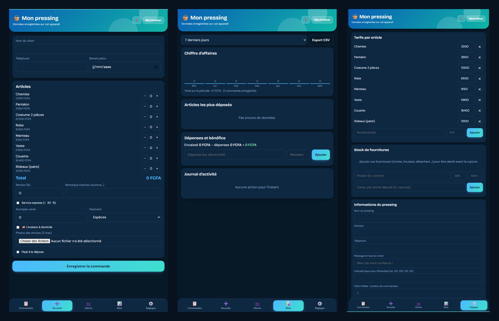

# 🧺 Pressing – Gestion des commandes

🇫🇷 [Français](#-français) · 🇬🇧 [English](#-english)

> Une app gratuite et open source de la série **DailyBuilds** : *1 app / semaine pour un vrai problème.*
> A free, open source app from the **DailyBuilds** series: *One useful app a week.*

---

## 🇫🇷 Français

### Le problème
Dans un pressing, les clients déposent des habits à toute heure. Sans système, on note sur un carnet, on mélange les vêtements, on ne sait plus qui a déposé quoi, ni si la commande est prête. Cette app remplace le carnet par un outil simple, utilisable sur téléphone comme sur ordinateur.

### Aperçu

▶️ **Démo (Short) :** [lien à ajouter]
🎓 **Tutoriel complet :** [lien à ajouter]
🌐 **Essayer en ligne :** [lien GitHub Pages à ajouter]

### Fonctionnalités

**Commandes et paiements**
- Total calculé automatiquement, avec remise et service express (supplément réglable, 30 % par défaut)
- Suivi des statuts : Reçu, En cours, Prêt, Retiré
- Alertes de retard et commandes prêtes depuis plus de 7 jours (« À relancer »)
- Acompte, reste à payer, paiement en espèces, Mobile Money ou carte
- Livraison à domicile (adresse et frais) et photos des articles (3 par commande)
- Recherche et filtres (statut, retards, relances, livraisons)

**Tickets et envoi au client**
- Ticket avec les informations du pressing, impression et PDF
- Étiquettes à code QR, une par vêtement
- Messages WhatsApp prêts à l'envoi : dépôt, commande prête, relance

**Clients, stock et bilan**
- Fiche client avec historique, reste dû et remise automatique pour les clients fidèles
- Stock de fournitures avec alerte « Stock bas »
- Bilan : chiffre d'affaires, articles les plus déposés, dépenses, bénéfice, journal des actions par employé
- Export CSV de toutes les commandes (lisible dans Excel)

**Réglages**
- Devises : euro, FCFA, dirham marocain, dinar algérien, dinar tunisien, dollar US, franc guinéen, franc congolais
- Mode sombre automatique, code de sécurité, guide d'utilisation intégré (bouton ❓)

### Installation
Aucune installation n'est nécessaire.

1. Clique sur **Code → Download ZIP** (ou télécharge le fichier `index.html` seul).
2. Décompresse le dossier si besoin.
3. Ouvre le fichier dans ton navigateur (Chrome, Firefox, Edge, Safari). Sur téléphone, ouvre-le depuis ton gestionnaire de fichiers, ou utilise la version en ligne.

### Utilisation
1. **Réglages (une seule fois)** : nom, adresse et téléphone du pressing, indicatif pays, devise, tarifs, supplément express, employés, code de sécurité (facultatif).
2. **Nouvelle** : choisis le client, ajoute les articles avec + et −, règle les options (express, remise, acompte, livraison, photos), puis enregistre.
3. **Commandes** : fais avancer le statut, encaisse le reste à payer, ouvre le ticket.
4. **Prévenir le client** : le bouton WhatsApp ouvre un message déjà écrit, adressé au numéro du client.

### ⚠️ Limites à connaître
- **Les données restent sur un seul appareil**, dans le navigateur. Effacer les données du navigateur les supprime : fais un **export CSV régulièrement**.
- **Pas de synchronisation** entre plusieurs appareils.
- Le **PDF, les codes QR et les polices** ont besoin d'une connexion internet (bibliothèques chargées depuis des serveurs externes).
- Le **code de sécurité** protège contre les fausses manipulations, mais ce n'est pas une sécurité forte : il fonctionne dans le navigateur et ne remplace pas la protection de ton téléphone ou de ton ordinateur.
- **Pas de comptes employés avec mot de passe** : le choix de l'employé sert à tracer les actions, pas à les bloquer.
- Pas d'impression Bluetooth directe, pas de forfaits.
- Le PDF ne peut pas être joint automatiquement à un lien WhatsApp : enregistre-le puis joins-le, ou utilise « WhatsApp + PDF » qui ouvre le menu de partage du téléphone.

### Données personnelles
L'app enregistre des noms, des numéros de téléphone et des photos de clients **sur ton appareil uniquement**. Protège ton appareil, ne partage pas les exports sans nécessité, et respecte les règles de protection des données applicables dans ton pays.

### Responsabilité
Cette app est un outil d'aide à la gestion. Les prix, les taxes et les obligations légales (comptabilité, facturation) restent de la responsabilité de l'utilisateur. Elle est fournie telle quelle, sans garantie.

### Comment elle a été construite
Créée avec **Claude IA** et **VS Code**, dans le cadre du défi DailyBuilds. Le tutoriel vidéo montre les étapes, erreurs comprises.

### Contribuer
Les idées et corrections sont les bienvenues : ouvre une *issue* ou une *pull request*.

### Prochaines améliorations (version 2)
- Agrandir les champs de tarifs, dont certains prix sont coupés
- Clarifier le libellé du champ d'alerte du stock
- Déplacer le bouton « Réinitialiser » dans les Réglages

Une idée ou un bug ? Ouvre une *issue*.

### Licence
Distribué sous licence MIT. Voir le fichier [LICENSE](LICENSE).

### Soutenir le projet
Si cette app t'a été utile : ⭐ mets une étoile au dépôt, partage-le, ou offre-moi un café sur [Ko-fi](https://ko-fi.com/dailybuilds_dev) ☕

---

## 🇬🇧 English

### The problem
In a dry-cleaning shop, customers drop off clothes all day long. Without a system, orders end up in a notebook, garments get mixed up, and nobody knows who dropped off what or whether an order is ready. This app replaces the notebook with a simple tool that works on phones and computers.

### Preview

▶️ **Demo (Short):** [link to add]
🎓 **Full tutorial:** [link to add]
🌐 **Try it online:** [GitHub Pages link to add]

### Features

**Orders and payments**
- Automatic totals, with discount and express service (adjustable surcharge, 30% by default)
- Status tracking: Received, In progress, Ready, Picked up
- Late-order alerts and orders ready for more than 7 days ("To follow up")
- Deposit, balance due, cash, Mobile Money or card
- Home delivery (address and fee) and item photos (3 per order)
- Search and filters (status, late, follow-ups, deliveries)

**Tickets and customer messages**
- Ticket with the shop's details, printing and PDF
- QR-code labels, one per garment
- Ready-to-send WhatsApp messages: drop-off, order ready, reminder

**Customers, stock and reports**
- Customer record with history, balance due and automatic discount for loyal customers
- Supplies stock with a "Low stock" alert
- Reports: revenue, most dropped-off items, expenses, profit, action log per employee
- CSV export of all orders (opens in Excel)

**Settings**
- Currencies: euro, CFA franc (FCFA), Moroccan dirham, Algerian dinar, Tunisian dinar, US dollar, Guinean franc, Congolese franc
- Automatic dark mode, security code, built-in user guide (❓ button)

### Installation
No installation required.

1. Click **Code → Download ZIP** (or download the `index.html` file alone).
2. Unzip the folder if needed.
3. Open the file in your browser (Chrome, Firefox, Edge, Safari). On a phone, open it from your file manager, or use the online version.

### Usage
1. **Settings (one time)**: shop name, address and phone, country code, currency, prices, express surcharge, employees, security code (optional).
2. **New**: choose the customer, add items with + and −, set the options (express, discount, deposit, delivery, photos), then save.
3. **Orders**: move the status forward, collect the balance, open the ticket.
4. **Notify the customer**: the WhatsApp button opens a pre-written message addressed to the customer's number.

### ⚠️ Limitations
- **Data stays on a single device**, in the browser. Clearing browser data deletes it: **export a CSV regularly**.
- **No sync** between multiple devices.
- **PDF, QR codes and fonts** need an internet connection (libraries are loaded from external servers).
- The **security code** protects against accidental actions, but it is not strong security: it runs in the browser and does not replace protecting your phone or computer.
- **No employee accounts with passwords**: the employee selection only traces actions, it does not restrict them.
- No direct Bluetooth printing, no subscription packages.
- A PDF cannot be attached automatically through a WhatsApp link: save it and attach it, or use "WhatsApp + PDF", which opens the phone's share menu.

### Personal data
The app stores customer names, phone numbers and photos **on your device only**. Protect your device, avoid sharing exports unnecessarily, and follow the data-protection rules that apply in your country.

### Responsibility
This app is a management aid. Prices, taxes and legal obligations (accounting, invoicing) remain the user's responsibility. It is provided as is, without warranty.

### How it was built
Built with **Claude AI** and **VS Code** as part of the DailyBuilds challenge. The video tutorial shows the steps, mistakes included.

### Contributing
Ideas and fixes are welcome: open an *issue* or a *pull request*.

### Next improvements (version 2)
- Widen the price fields, where some prices are cut off
- Clarify the stock alert field label
- Move the "Reset" button into Settings

An idea or a bug? Open an *issue*.

### License
Released under the MIT License. See the [LICENSE](LICENSE) file.

### Support the project
If this app helped you: ⭐ star the repo, share it, or buy me a coffee on [Ko-fi](https://ko-fi.com/dailybuilds_dev) ☕

---

Fait avec ❤️ au Togo 🇹🇬 · Made with ❤️ in Togo · <b>DailyBuilds</b>

